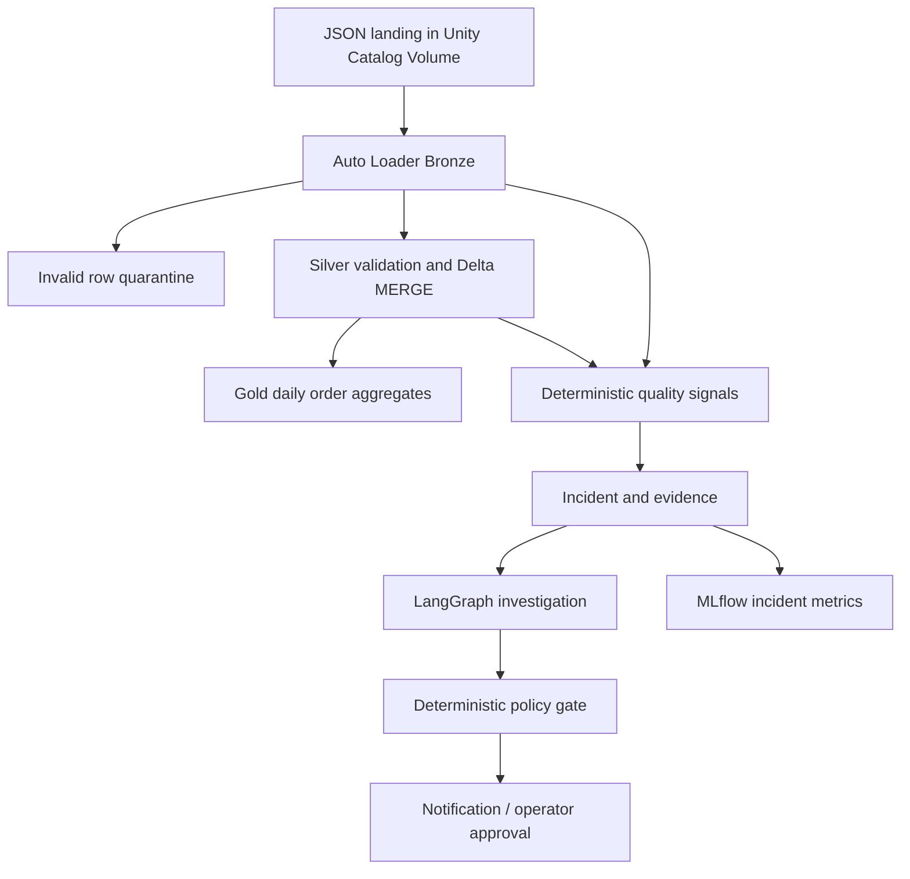
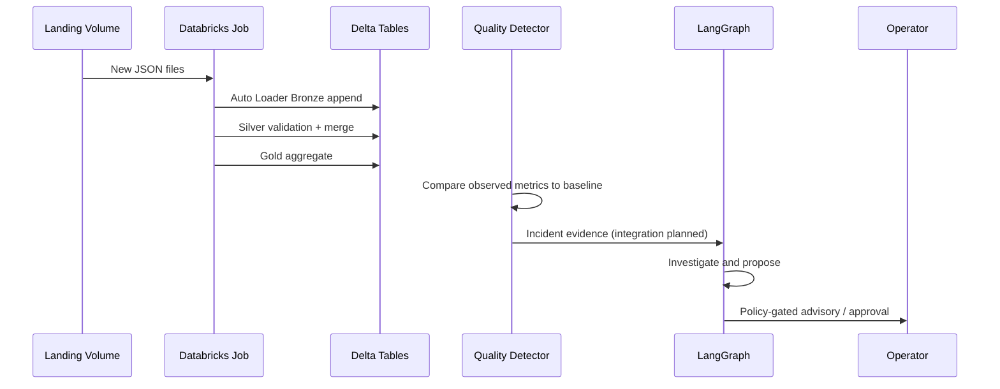

# LakeGuard AI

**Policy-gated Agentic Data Reliability for Databricks Lakehouse**

> Status: **reference implementation / starter repository**, not a certified production deployment. The Bronze–Silver–Gold batch path, deterministic detectors, policy engine, and LangGraph advisory workflow are implemented. The enterprise-scale streaming, fully autonomous remediation, and integrated monitoring features below are a roadmap, not claimed as shipped.

## Why this project exists

LakeGuard illustrates how enterprise data platforms can combine Delta Lake reliability with auditable AI-assisted incident response. It separates deterministic detection and authorization from language-model reasoning so a hallucinated diagnosis cannot mutate production data.

## Architecture





## Repository structure

- `lakeguard/`: typed config, quality checks, incident model and authorization policy
- `pipelines/`: Auto Loader Bronze, PySpark Silver, Gold aggregate
- `agents/`: LangGraph advisory triage, optional MLflow metrics, HTTPS notification
- `infrastructure/`: Databricks Asset Bundle job definitions
- `tests/`: deterministic pytest unit tests
- `config/`: sample declarative pipeline metadata
- `data/`: small synthetic order examples

## Quick start (local)

```bash
python -m venv .venv
source .venv/bin/activate  # Windows: .venv\Scripts\activate
pip install -e '.[dev,agent]'
pytest -q
ruff check lakeguard agents tests
python -c 'from agents.workflow import build_graph; print(build_graph().invoke({"incident_id":"demo","evidence":{"null_rate":0.2},"approved":False}))'
```

Local tests cover policy and anomaly functions; Databricks jobs require a Databricks workspace, Unity Catalog, a compatible runtime and credentials.

## Databricks setup

1. Create or select a Unity Catalog catalog and schema, e.g. `main.lakeguard`.
2. Create a managed Volume at `main.lakeguard.landing` and a Volume for checkpoints; adjust the paths in `infrastructure/databricks.yml` to your environment. The default sample path is illustrative and does not create these objects.
3. Upload JSON lines from `data/sample_orders.json` to the `orders` folder under the landing Volume. For Auto Loader JSON, use a valid JSONL file.
4. Install Databricks CLI, authenticate to your workspace, then from `infrastructure/` run:

```bash
databricks bundle validate -t dev
databricks bundle deploy -t dev
databricks bundle run lakeguard_orders -t dev
```

5. Verify Bronze, Silver, quarantine and Gold tables. Confirm workspace-specific cluster policies, node types and DBR compatibility before deploying. The sample job uses an Azure VM SKU; adjust it for your cloud and policy.
6. For production, add job identity, Unity Catalog least-privilege grants, secret-backed endpoints, budgets, alerts, audit retention and isolated dev/prod catalogs.

**Important:** The bundled Python scripts use `delta.tables` in the Silver task, which is provided by the Databricks runtime. This repository does not run Spark integration tests in CI.

## Pipeline semantics and known limitations

- **Bronze:** Auto Loader JSON ingestion with rescued data, schema inference location and checkpoint. The source does not currently include a CSV/API normalization adapter; land those formats as JSON or add an adapter.
- **Silver:** batch reconciliation of Bronze into a latest-event-per-order table. A timestamp plus ingestion timestamp resolves most duplicates; equal ties are not guaranteed deterministic. Invalid rows append to quarantine; retry-safe quarantine deduplication is not implemented.
- **Gold:** full overwrite of daily metrics. Prefer partition-scoped recompute or incremental change data feed for large volumes.
- **Config:** a validated sample schema is provided, but the job task arguments are currently declared in the bundle rather than dynamically loaded from YAML.
- **Monitoring:** quality detectors are implemented as Python functions, not yet scheduled and wired to live Spark metrics.
- **Agent:** LangGraph runs a deterministic advisory graph; no LLM reasoning, Spark event-log reader, Jobs API action executor, or autonomous remediation is wired in this release.
- **MLflow:** an optional metrics helper exists, but it is not yet invoked automatically by the job.
- **Watermarks:** Auto Loader checkpoint tracks file ingestion progress; an explicit business-event watermark/control table is not yet implemented.

## Design trade-offs

| Decision | Benefit | Trade-off |
|---|---|---|
| Auto Loader | Incremental discovery and checkpointing | Databricks-specific runtime |
| Batch Silver MERGE | Easy replay and debugging | Reprocesses all Bronze rows; not yet scalable |
| Deterministic rules | Auditable and testable | Less adaptive than learned baselines |
| LangGraph advisory mode | Clear control boundaries | Not yet an autonomous operations agent |
| Unity Catalog tables | Governance and discoverability | Requires workspace provisioning |
| DABs | Reproducible job definitions | Cloud/runtime configuration required |

## Production hardening roadmap

**Phase 1:** Add idempotent quarantine MERGE, source file IDs, deterministic tie-breaking, config-driven task generation, Delta control tables (`pipeline_config`, `pipeline_runs`, `watermarks`, `dq_results`, `incidents`, `agent_actions`).

**Phase 2:** Add JSON/CSV/API adapters, true incremental Silver streaming via `foreachBatch`, event-time watermark policy, CDC/SCD semantics, Gold incremental maintenance, and failure recovery tests.

**Phase 3:** Connect Spark event logs, Databricks Jobs API and MLflow traces to evidence retrieval. Add configurable Mosaic AI serving model, structured LLM outputs, confidence/verification, approval persistence, bounded job retry, quarantine execution and notifications. Never allow unrestricted SQL or arbitrary Python execution by the model.

**Phase 4:** Add performance tests at 1M/10M/100M rows, controlled fault injection, reproducible benchmarks, deployment smoke tests, cost monitoring, and documented mean-time-to-detect/resolve metrics.

## Related Publications

LakeGuard AI builds on technical research and industry perspectives concerning enterprise data reliability, intelligent anomaly detection, and Agentic AI-driven data operations.

The following publications explore concepts related to the architecture and engineering principles demonstrated in this repository.

**1. AI-Driven Enterprise Data Ingestion Framework: How Lokeshkumar Madabathula Is Transforming Global Analytics Platforms**
**Publication:**AI Journal
**Author:** Lokeshkumar Madabathula
**Article:** https://aijourn.com/ai-driven-enterprise-data-ingestion-framework-how-lokeshkumar-madabathula-is-transforming-global-analytics-platforms/
**Relevance:** Discusses AI-driven enterprise data engineering, architectural considerations, and operational reliability.

**2. From Anomaly Detection to Agentic AI: Engineering Intelligent Data Reliability on Databricks**
**Publication:** HackerNoon
**Author:** Lokeshkumar Madabathula
**Article:** https://hackernoon.com/from-anomaly-detection-to-agentic-ai-engineering-intelligent-data-reliability-on-databricks
**Relevance:** Examines the evolution of traditional anomaly detection toward intelligent, agent-assisted investigation and remediation in enterprise data systems.
---

## License

## Security

Never commit tokens, webhook URLs or customer data. Restrict Unity Catalog privileges; use service principals and secret scopes. Keep remediation actions behind explicit authorization, idempotency keys and an immutable audit record. The sample `agents/webhook.py` should only receive trusted, preapproved destinations; it is not a general-purpose user-input URL fetcher.

## License

MIT. See `LICENSE`.
